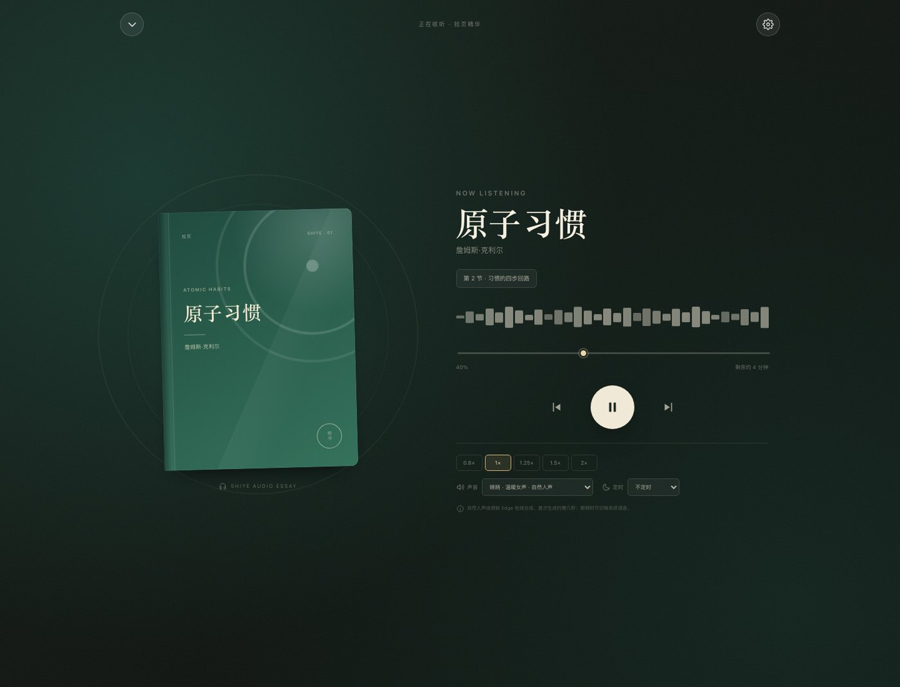
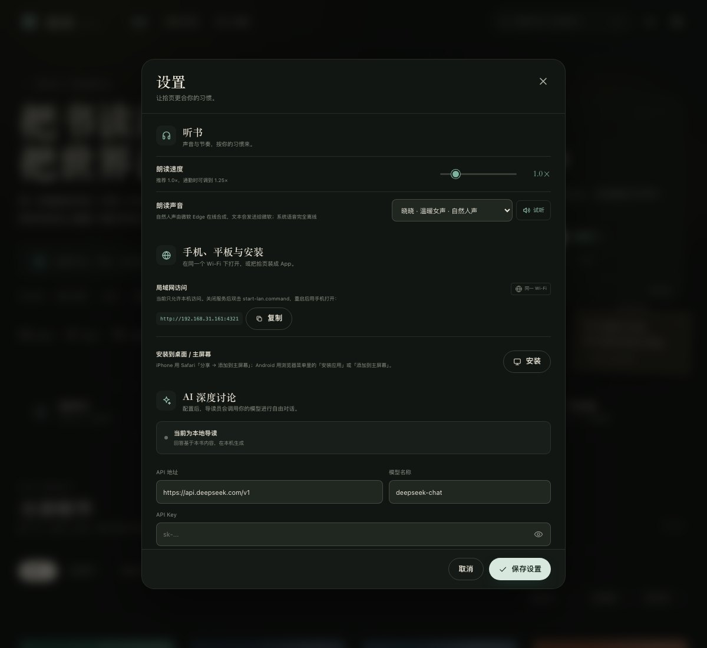
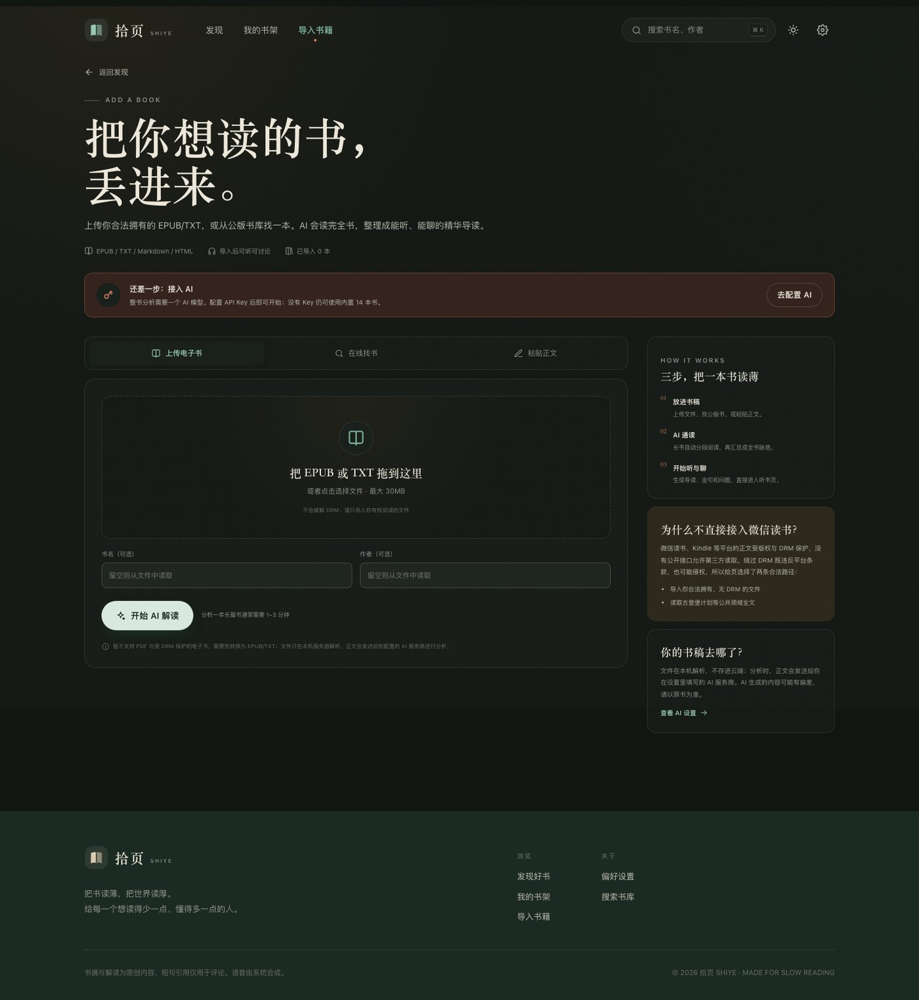
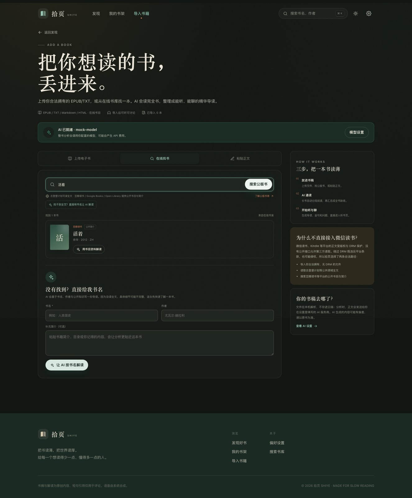

# 拾页 SHIYE


> 把书读薄，把世界读厚。
> 用一杯咖啡的时间听完一本书的精华，再和导读员认真聊一聊。

拾页是一个本地优先的「精华听书 + 深度讨论」Web 应用。内置 14 本严选书，也可以导入自己的 EPUB/TXT，或从公开书库找书，让 AI 读完并生成一份可听、可聊的精华导读。

## 预览

| 书籍详情 | 沉浸听书 |
| --- | --- |
|  |  |

## 功能

- **精华书库**：内置 14 本严选书，覆盖自我提升、思维认知、商业财经、心理成长、文学小说、历史人文、沟通关系与科幻未来；导入的书会收进「我的导入」。
- **导入任意一本书**：上传 EPUB/TXT/Markdown/HTML，或粘贴正文；AI 分段通读后生成完整导读。长书会覆盖全文或按比例抽样，并在书上标明覆盖率。
- **在线找书**：搜索豆瓣读书的公开书目、古登堡计划公版全文、Google Books 和 Open Library；公版书可直接读全文，其他书基于公开简介 + 模型知识生成导读。
- **只有书名也能读**：任何不在书库里的书，输入书名和作者即可让 AI 生成一份导读（会明确标注未读取全文，可能有偏差）。
- **搜索与筛选**：全局搜索会边输入边检索本地精华与豆瓣/古登堡/Google Books/Open Library，输入两三个字或一个关键词即可，不必打完整书名；单字也会尝试豆瓣搜索页。支持按领域、时长、难度筛选，按评分、时长、出版时间排序。
- **听书**：默认使用微软 Edge 神经网络自然人声（晓晓、云希等 6 种中文音色），也保留离线系统语音；支持播放 / 暂停、上一节 / 下一节、0.8×–2× 语速、声音试听、定时关闭、断点续听。
- **同步高亮**：朗读到哪一段，页面就高亮哪一段；可在「章节听书」里跟着文字听。
- **精华解读**：一句话读懂、核心观点、章节脉络、行动清单、争议与边界、适合谁读。
- **AI 深度讨论**：每个书页内置讨论区。没有 API Key 时使用**本地导读**（基于书中内容生成回答）；配置 Key 后可调用任意 OpenAI 兼容接口，进行流式对话。
- **金句与笔记**：收藏金句、写自己的笔记；书架集中回看。
- **书架与统计**：继续收听、收藏、笔记、收听时长、连续天数、最近浏览。
- **深浅色 / 响应式 / PWA**：桌面与手机均可使用；支持添加到主屏幕。

## 启动

需要 Node.js 18+，无需安装任何 npm 依赖。

自然人声还需要本机有 Python 3.9+；相关依赖已经放在 `vendor/edge-tts` 里，不需要再 `pip install`。如果你的环境无法运行它，拾页会自动回退到系统语音。

```bash
node server.mjs
```

然后打开 <http://127.0.0.1:4321>。

在 macOS 上也可以直接双击 `start.command`，它会启动服务并打开浏览器。

默认只监听 `127.0.0.1`，所以其他设备打不开；这是为了不让 AI 代理和朗读服务暴露到局域网。可用环境变量修改：

```bash
PORT=4322 HOST=127.0.0.1 node server.mjs
```

### 在手机 / 平板上打开

让电脑和手机连接**同一个 Wi-Fi**，然后：

1. 关闭原来的拾页服务；
2. 双击 `start-lan.command`（或运行 `HOST=0.0.0.0 node server.mjs`）；
3. 终端会打印类似 `http://192.168.1.23:4321` 的地址；
4. 在手机浏览器里打开这个地址。

也可以在拾页的「设置 → 手机、平板与安装」里看到并复制这个地址。



注意：

- 手机上的 `localhost` 指的是手机自己，必须用电脑的局域网 IP；
- 电脑不能休眠，服务要一直运行；
- macOS 如果弹出防火墙提示，需要允许 Node 接受连接；
- 只在家庭 Wi-Fi 使用这个模式，不要在公共网络上开启；
- AI Key 和书架数据保存在各自的浏览器里，手机需要重新填写 Key，数据也不会自动同步。

### 安装成 App

拾页本身是一个 PWA，可以脱离浏览器窗口运行（局域网版只能在同一 Wi-Fi 下使用；要真正独立、在外网也能用，请看 [DEPLOY.md](DEPLOY.md) 的云端部署）：

- **Mac**：用 Chrome 打开本地地址，点地址栏右侧的安装图标，或「设置 → 手机、平板与安装 → 安装」；
- **iPhone / iPad**：用 Safari 打开，点「分享」→「添加到主屏幕」；
- **Android**：用 Chrome 打开，点右上角菜单 →「安装应用」或「添加到主屏幕」。

局域网 HTTP 地址在部分 Android 浏览器上只能创建快捷方式；要获得完整的离线 PWA/安装能力，需要 HTTPS 域名。真正上架 App Store / 应用商店则需要另外打包签名，不是当前本地版的范围。

## 配置 AI 讨论（可选）

1. 打开右上角「设置」→「AI 深度讨论」。
2. 填入 API 地址、模型名和 API Key。默认已填好 DeepSeek：
   - API 地址：`https://api.deepseek.com/v1`
   - 模型：`deepseek-chat`
   - Key 获取：<https://platform.deepseek.com/api_keys>
3. 保存后回到任意书的「和书讨论」，状态会变成「AI 深度讨论」。

也支持其他 OpenAI 兼容服务（如 OpenAI、Moonshot、SiliconFlow 等），只要它们提供 `/chat/completions` 接口。

如果不想使用付费 API，可以在设置里点「Ollama 本地」，然后在本机安装 [Ollama](https://ollama.com/) 并拉取模型，例如：

```bash
ollama pull qwen2.5:7b
```

本地模型的速度和效果取决于电脑配置；导入整本书时同样会多次调用模型，耗时可能更长。

### 关于声音

- 默认使用 **微软 Edge 神经网络语音**（晓晓、晓伊、云希、云健、云扬、晓北），比系统 TTS 自然很多。
- 首次播放某一段需要几秒到十几秒生成音频，生成后会缓存；下一段会在当前段播放时预生成。
- 自然人声需要联网，**朗读文本会发送给微软的语音服务**；如果不想联网，可以在播放器或设置里切换到「系统语音 · 离线」。
- 设置里可以点「试听」比较不同音色。系统语音的音质取决于电脑上安装的语音包。
- 试听样本：[晓晓 · 温暖女声](assets/voice-sample-xiaoxiao.mp3) / [云希 · 阳光男声](assets/voice-sample-yunxi.mp3)
- 自然人声使用开源的 [edge-tts](https://github.com/rany2/edge-tts)（LGPL-3.0，已放在 `vendor/`），底层调用微软 Edge 在线语音服务。

**隐私说明**：Key 只保存在本机浏览器 `localStorage`，请求会经过本地 `server.mjs` 的 `/api/chat` 代理转发到你填写的 API 地址。请不要在公共设备上填写 Key，也不要把带 Key 的浏览器数据分享给他人。部署到公网前，应改为服务端保存密钥并加入鉴权。


## 导入一本书



打开 **导入书籍**（顶部导航），有三种方式：

### 1. 上传电子书

支持 `.epub`、`.txt`、`.md`、`.markdown`、`.html`、`.htm`，最大 30MB。EPUB 会自动读取书名、作者和章节；TXT 会自动识别 UTF-8 / GB18030 编码。

分析流程：

1. 服务端在本机解析文件，不保存你的原始文件；
2. 按篇幅切成若干段，逐段生成阅读笔记；
3. 再汇总成结构化导读：一句话、核心观点、章节、金句、行动清单和讨论问题；
4. 生成的书会出现在「我的导入」，可以听、收藏、记笔记、讨论，也可以删除。

**暂不支持 PDF、MOBI、AZW3 和带 DRM 的电子书。** 请先转换为 EPUB/TXT；拾页不会绕过 DRM。

### 2. 在线找书



全局搜索和“导入书籍”的在线搜索都会同时查询：

- **豆瓣读书**：公开书目信息（书名、作者、年份、版次）；选中后读取该书的公开简介，基于简介 + 模型知识生成导读，不读取全文或书评，也不需要登录；
- **古登堡计划**：公共领域全文，可直接下载全文分析；
- **Google Books / Open Library**：公开书目与简介，选中后基于简介 + 模型知识生成导读。

搜索会优先返回豆瓣等响应较快的来源，避免被连接超时的外部书库拖住。

注意：这些是公开书目/公版书源，不包含微信读书、Kindle 等需要登录的版权平台正文。后者没有允许第三方读取正文的公开接口，绕过 DRM 会违反平台条款，也可能侵权，所以没有接入。豆瓣部分只取公开书目与简介，不抓取全文、书评或用户数据。

### 3. 只有书名 / 粘贴正文

- **只有书名**：输入书名、作者和可选简介，AI 会基于公开知识生成导读，并在书上标注「未读取全文」。
- **粘贴正文**：适合没有电子书文件、但能复制较长正文的情况。

### 关于 AI 分析

- 导入分析**必须配置 AI**；内置的 14 本书不需要。
- 长书通常分成 2–12 段，耗时约 1–3 分钟，也可能产生多次 API 费用。
- 生成内容可能遗漏或误读书中细节，请以原书为准；页面会标明分析来源与全文覆盖率。
- 文件在本地服务解析；分析时正文会发送给你填写的 AI 服务商。

## 目录结构

```
index.html              页面外壳
css/styles.css          全部样式（设计系统 / 响应式 / 深色）
js/data.js              14 本书的精华内容与分类
js/app.js               路由、全局交互、启动
js/views/home.js        发现页、搜索筛选
js/views/book.js        书籍详情、解读、章节、金句
js/views/chat.js        讨论区与流式对话
js/views/shelf.js       书架与笔记
js/views/import.js      导入页：上传 / 找书 / 粘贴
js/analyze.js           长书分段分析与结构化导读
js/search.js            全局搜索浮层
js/player.js            迷你播放器与全屏播放器
js/tts.js               朗读引擎（Edge 自然人声 + 系统语音回退）
js/ai.js                本地导读 + AI 接口
js/settings.js          设置面板（AI / 声音 / 手机访问 / 安装）
js/store.js             本地数据持久化
server.mjs              静态服务 + AI 代理 + EPUB/TXT 解析 + 公开书库搜索 + 自然人声合成
tools/edge_tts_cli.py   Edge 自然人声桥接脚本
vendor/edge-tts         随应用携带的 Edge TTS Python 依赖（LGPL-3.0）
sw.js                   Service Worker（网络优先 + 离线兜底）
start.command           本机启动
start-lan.command       局域网启动（手机/平板访问）
```

## 添加一本内置书（开发者）

普通阅读不需要改代码，用「导入书籍」即可。如果要把它加入内置书库，在 `js/data.js` 的 `rawBooks` 数组中追加一个对象，字段可参考任意现有条目：

```js
{
  id: 'my-book',
  title: '书名',
  enTitle: 'BOOK TITLE',
  author: '作者',
  authorBio: '作者简介',
  category: 'growth',        // 见 CATEGORIES
  tags: ['标签'],
  year: 2024,
  rating: 4.5,
  ratings: 1000,
  difficulty: '轻松',
  cover: { a: '#1F4A3D', b: '#34705B', ink: '#F3E9D2', motif: 'orbit', no: '15' },
  tagline: '一句话推荐语',
  oneLiner: '一句话读懂',
  intro: '导读段落',
  whyRead: ['理由一', '理由二', '理由三'],
  keyIdeas: [{ title: '核心观点', body: '解释' }],
  sections: [{ title: '章节标题', paras: ['段落一', '段落二'], takeaway: '本节小结' }],
  quotes: [{ text: '短句', source: '意译' }],
  actions: ['可执行动作'],
  audience: '适合谁读',
  debate: { title: '争议与边界', body: '边界说明' },
  questions: ['讨论问题'],
  related: ['atomic-habits']
}
```

听书时长由正文字数自动计算，无需手动填写。

## 内容说明

- 所有书籍解读均为**原创中文摘要与评论**，不是原文替代品。
- 短句引用仅用于评论与记忆，部分标注为「意译」或「导读」；请以正式出版物为准。
- 内置书的评分、听众数等为演示数据。
- 自然人声由微软 Edge 在线语音服务生成，需要联网；系统语音由浏览器与操作系统提供。没有中文语音包时，可在系统设置中安装。
- 想安装到别的设备并在外网使用，需要把服务部署到公网；见 [DEPLOY.md](DEPLOY.md)。
- 导入书的 AI 解读由你配置的模型生成，不代表拾页的立场，也不保证准确；请保留自己的判断。
- 在线搜索依赖外部书库（古登堡计划、Google Books、Open Library）的网络可用性；如果搜索失败，仍可上传文件或直接按书名解读。

## 技术说明

- 纯原生 HTML / CSS / JavaScript ES Modules，无构建步骤、无运行时依赖。
- 本地数据使用 `localStorage`，键名 `shiye.store.v1`。
- 语音使用 Web Speech API（`speechSynthesis`），按句切分以保证高亮与稳定性。
- AI 通过本地同源代理调用，规避浏览器 CORS 限制；代理不记录 Key。
- Service Worker 采用「网络优先、缓存兜底」策略，避免更新后看到旧页面。
- 导入分析支持 OpenAI 兼容接口；服务端 `/api/extract` 负责 EPUB/TXT 解析，`/api/catalog` 负责公开书库搜索，`/api/catalog/text` 负责公版全文下载。

祝你读得少一点，懂得多一点。
